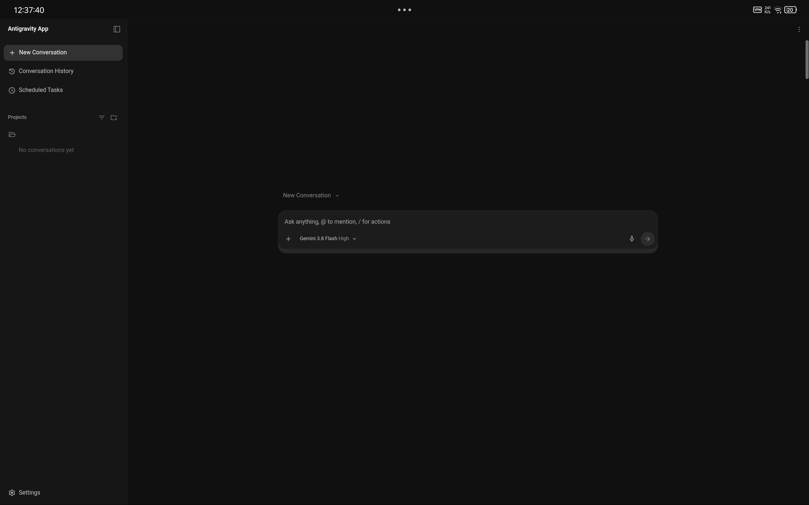

<div align="center">

  <p>
    <a href="README.md">English</a> &nbsp;&bull;&nbsp; <b>Русский</b>
  </p>

  <br/>

  

  # Antigravity для Android

> [!WARNING]
> **Проект временно приостановлен на несколько месяцев из-за занятости разработчика.**

**Автономная среда разработки на базе ИИ, работающая нативно на Android и ARM64.**

  [](https://android.com)
  [](https://arm.com)
  [](https://github.com/werdio325-png/antigravity-android/releases)
  [](LICENSE)

  <br/>

  <picture>
    <source media="(prefers-color-scheme: dark)" srcset="docs/assets/hero_dark.png">
    <source media="(prefers-color-scheme: light)" srcset="docs/assets/hero_light.png">
    
  </picture>

</div>

---

### Обзор

**Antigravity для Android** переносит автономное агентное программирование прямо на мобильное устройство.

Никаких PRoot, chroot или накладных расходов виртуализации. Antigravity исполняется **нативно в пространстве пользователя Android (Bionic)**, раскрывая полную скорость физических ядер CPU и накопителей UFS. Агент на базе моделей Gemini автономно анализирует кодовую базу, редактирует файлы проекта, компилирует бинарники и запускает тесты полностью локально.

---

### Главное в v2.4

* **Модульная архитектура:** Разделение ядра на 6 изолированных подсистем (`modules/*`) с отдельными тестами.
* **Нативный сплэш:** Отрисовка анимации точек на Canvas экономит ~40 МБ RAM и ускоряет запуск.
* **Desktop Mode:** Мгновенный переключатель в настройках *Appearance* для планшетов, клавиатур и Samsung DeX.
* **Поддержка ARMv8.0-A:** Встроенная эмуляция атомиков и SIMD (`liblse_compat.so`) для старых чипсетов.
* **Фоновый микро-демон:** Легковесный `agy-daemon` (<10 МБ RAM) с планировщиком cron, слежением за файлами и очередью AI-задач.

---

### Ключевые возможности

* **Автономный агент:** Планирует задачи, правит код по всему проекту, вызывает консольные инструменты и устраняет ошибки сборки.
* **Привилегии Shizuku:** Прямой доступ к ADB-оболочке (`uid=2000`) без root для установки пакетов и чтения системных логов.
* **Встроенный менеджер `pkg`:** Быстрая установка инструментариев (`git`, `python`, `node`, `clang`) из репозиториев Termux.
* **Адаптивный интерфейс:** Удобное сенсорное управление на телефоне с возможностью переключения в десктопный вид.
* **Бесшовные обновления:** Единый ключ подписи гарантирует сохранение сессий и проектов при обновлении APK.

---

### Быстрый старт

1. **Скачайте APK** со страницы [Releases](https://github.com/werdio325-png/antigravity-android/releases):
   * `antigravity.apk` — стандартная версия (оригинальные проверки Google).
   * `antigravity-region-bypass.apk` — версия с обходом проверки учетных записей.
2. **Предоставьте доступ к памяти** (`Все файлы`). *(Опционально: подключите Shizuku для доступа к ADB)*.
3. **Установите рабочее окружение** в терминале или через агента:
   ```bash
   pkg update && pkg install git python nodejs
   ```

---

### Сборка и тестирование

```bash
# Сборка стандартного релизного APK (dist/antigravity.apk):
bash build.sh

# Сборка релизного APK с обходом проверок (dist/antigravity-region-bypass.apk):
bash build.sh --region-bypass

# Запуск полного набора тестов:
bash test_all_modules.sh
```

---

### Структура проекта

```text
antigravity/
├── config/             # Константы приложения, пути окружения и правила агента
├── modules/            # Модульная архитектура ядра (v2.4+)
│   ├── core/           # Распаковка, glibc-линковщик, системные шимы, SHA-256
│   ├── patches/        # Движок бинарного патчинга (системные вызовы, DNS, SIGILL)
│   ├── io/             # Шина ввода-вывода (I/O Bus): event broker, FIFO, сокеты
│   ├── env/            # Резолвер путей, диагностика, логи Flight Recorder, CLI
│   ├── builder/        # Сборщик APK без Gradle (javac, D8, aapt, zipalign, apksigner)
│   └── runner/         # Подготовка рантайма, health probe, E2E тесты
├── app/                # Android-хост (нативный сплэш, WebView, мосты)
├── web/                # Веб-интерфейс, переключатель desktop mode, темы
├── env/                # Bionic userspace, оверлей Termux, менеджер pkg, liblse_compat
├── docs/assets/        # Скриншоты, баннеры и диаграммы
├── build.sh            # Корневой скрипт сборки APK
└── test_all_modules.sh # Полный набор тестов для всех 6 модулей
```

> [!TIP]
> Каждый модуль в `modules/`, `app/`, `web/` и `env/` содержит собственный файл `README.md` с глубоким описанием архитектуры и компонентов.

---

<div align="center">
  <sub>Распространяется под лицензией <a href="LICENSE">Apache 2.0</a></sub>
</div>
